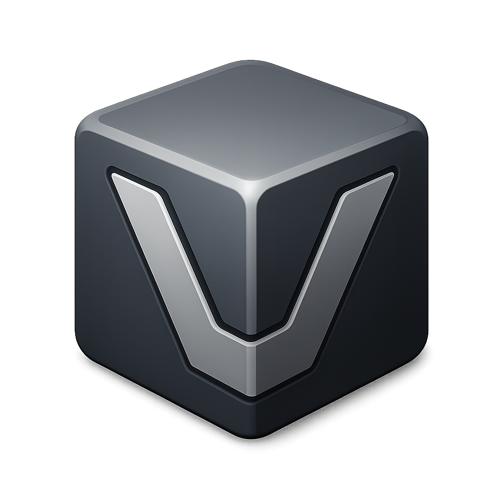
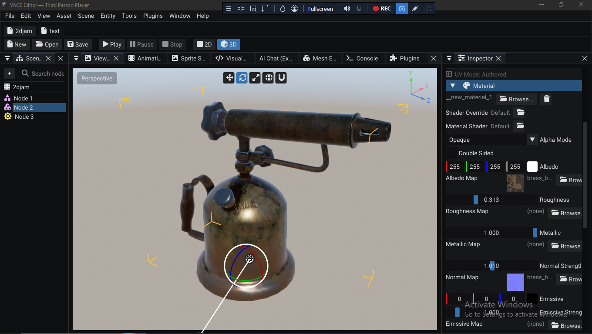
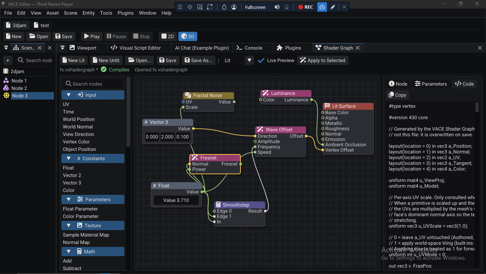
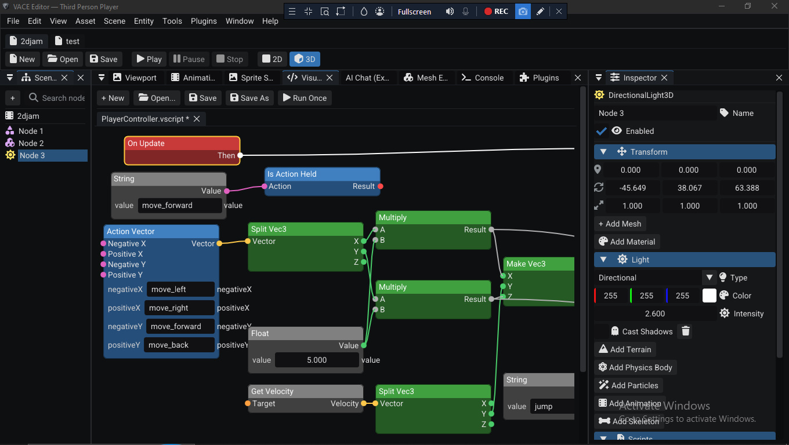
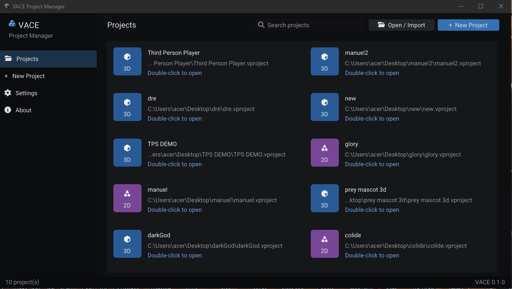
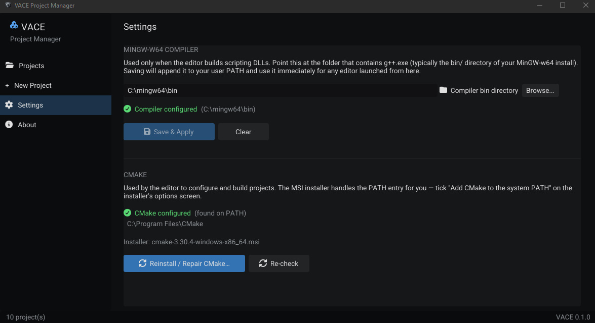
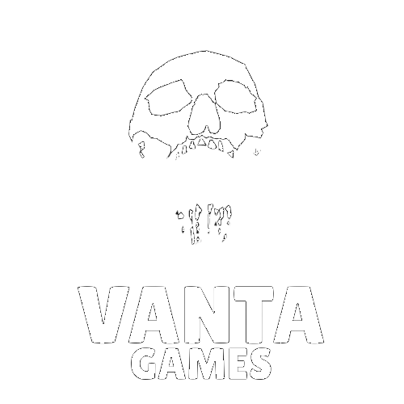

# VACE v0.1.0 — First public release

**A C++ game engine with a full editor, built from scratch by Vanta Games.**

2D and 3D · PBR rendering · Jolt + Box2D physics · Shader graph · Visual scripting · C++ scripting · Plugin system

---

The first stable release of VACE. Editor, runtime, and bundled documentation, in one zip.

## Download

## Download link - https://github.com/IsaacAduDarko/Vace-Engine-Release/releases/tag/Vace-Engine

**`vace_engine_windows_stable_v0.1.zip`** — the full engine, editor, runtime, and bundled documentation. Extract it anywhere you can write to, then run `build\windows-mingw-debug\projectmanager\VACE_ProjectManager.exe` to get started.

Optional: **MinGW-w64** if you plan to write C++ scripts. The release's Project Manager handles the setup, adding the compiler to your PATH and configuring CMake automatically. See [Installation](docs/installation.html#toolchain) for details.

## Screenshots

*The editor: scene hierarchy, viewport, inspector, and console*

 

<table>
<tr>
<td width="50%" align="center" valign="top">

*Shader graph*

</td>
<td width="50%" align="center" valign="top">

*Visual scripting*

</td>
</tr>
<tr>
<td width="50%" align="center" valign="top">

*Project Manager: projects*

</td>
<td width="50%" align="center" valign="top">

*Project Manager: toolchain setup*

</td>
</tr>
</table>

## Requirements

- Windows 10 or 11, 64-bit
- A GPU with **OpenGL 4.3** support. Older GPUs (including many from before 2012) will not run the editor.
- 4 GB RAM minimum, 8 GB recommended

CMake is bundled with the release. MinGW-w64 is optional and only needed for C++ scripting.

## What's in v0.1.0

**Rendering**
- OpenGL 4.3 renderer behind an abstraction layer for future backends
- PBR pipeline with HDR, IBL, SSAO, bloom, and tone mapping
- Dynamic lighting, anti-aliasing
- Material system with data-driven shaders
- Shader graph

**Physics**
- 3D via Jolt Physics
- 2D via Box2D

**Scripting**
- C++ scripting via `VACE::Script` (ABI v7)
- Visual scripting
- Plugin system

**Animation and content**
- Skeletal (`.glb`) and sprite (`.vsprite`) animation
- Animation timeline
- Spritesheet editor
- Inverse kinematics
- Particles

**UI and input**
- UI system (text, buttons, sliders, images, colors, interaction)
- Keyboard, mouse, gamepads, named actions

**Tooling**
- Full editor: scene tree, inspector, viewport, console
- Project Manager with automated MinGW-w64 and CMake setup
- JSON save data

## Known limitations

- `VACE_FIELD()` inspector fields reflect in the editor but editing them does not yet change the value the running script sees. Set default values in the class body for now.
- Windows only. Other platforms are planned but not shipped in v0.1.0.
- Some editor panels and settings may change in future releases.

## Documentation

Every release ships with the docs in the `docs/` folder. They work offline and open from the editor's **Help → Documentation** menu. You can also read them on GitHub:

- [Overview](docs/index.html)
- [Getting started](docs/getting-started.html)
- [Installation](docs/installation.html)
- [Editor walkthrough](docs/editor.html)
- [Script API reference](docs/scripting.html)
- [ABI & types](docs/abi.html)
- [About](docs/about.html)

## Getting help

- **Discord** (fastest): https://discord.gg/vjYZsQzuMq
- **Issues**: https://github.com/IsaacAduDarko/vace/issues
- **Email**: isaacadudarko1@gmail.com

If you are reporting a crash or a script that will not load, please include the editor console output. It usually contains the exact error.

## License

VACE is free to use. You can build and ship games with it at no cost. The source code is not open source; redistributing or modifying the engine itself is not permitted. Full terms: [LICENSE.txt](docs/LICENSE.txt).

## What's next

Vanta Games is using VACE to develop its own games, and the engine will continue to expand alongside that work. Planned directions include more rendering backends behind the abstraction layer, additional platforms, and finishing the inspector-field persistence work. Nothing on this list is a commitment; direction depends on what users need most.

---

**Thank you for trying VACE.**

Bug reports, feedback, and questions all land fastest on the [Discord](https://discord.gg/vjYZsQzuMq).

